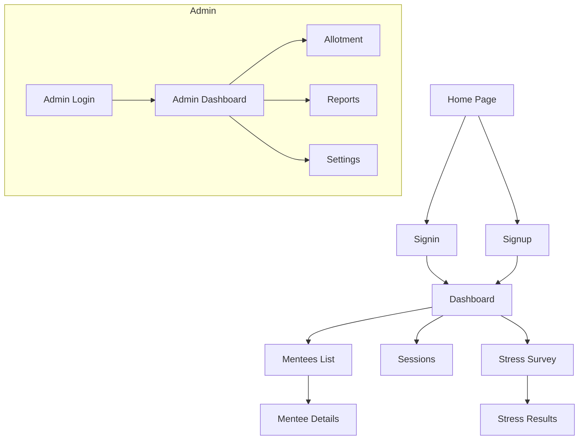

# 🎓 Faculty–Student Mentoring System

A professional mentoring platform built with **Vite + React (TypeScript)**.  
This repository is structured into **two apps**:

- **`frontend/`** → Students & Mentors  
- **`admin/`** → Administrators (Dean, Principal office)

---

## ✨ Features

- 🔐 Authentication (Sign in / Sign up)  
- 📊 Role-based dashboards (Mentor, Mentee, Admin)  
- 📁 Mentee records (attendance, grades, skills, career checklist)  
- 📅 Mentoring sessions (schedule, group/1:1 notes, confidential flags)  
- 🧠 Stress survey (Part B) + results visualization  
- 🛠 Admin tools: Allotment, Reports, Settings  

---

## 🗂️ Recommended Folder Structure

```text
jss-frontend/
├── admin/                       # Admin-only app
│   ├── public/
│   └── src/
│       ├── components/
│       │   ├── Navbar.tsx          # Admin navigation bar
│       │   ├── Sidebar.tsx         # Side navigation menu
│       │   └── StatCard.tsx        # KPI display cards
│       │
│       ├── lib/
│       │   └── api.ts              # API helpers for admin
│       │
│       ├── pages/
│       │   ├── Login.tsx           # Admin login
│       │   ├── Dashboard.tsx       # Admin dashboard (KPIs)
│       │   ├── Allotment.tsx       # Assign mentees to mentors
│       │   ├── Reports.tsx         # Generate/export reports
│       │   └── Settings.tsx        # Manage policy, rubric, schema
│       │
│       ├── App.tsx                 # Root component + Router
│       ├── main.tsx                # Entry point
│       ├── index.css               # Global styles
│       └── vite-env.d.ts           # TypeScript defs for Vite
│
├── frontend/                    # Student + Mentor app
│   ├── public/
│   └── src/
│       ├── components/
│       │   ├── Footer.tsx         # Footer UI
│       │   ├── NavBar.tsx         # Navigation bar
│       │   └── Sidebar.tsx        # Sidebar for dashboards
│       │
│       ├── lib/
│       │   ├── utils.ts           # Utility helpers
│       │   └── api.ts             # API client for frontend
│       │
│       ├── pages/
│       │   ├── Home.tsx           # Landing page
│       │   ├── Signin.tsx         # Login page
│       │   ├── Signup.tsx         # Registration
│       │   ├── Dashboard.tsx      # Mentor/Mentee dashboard
│       │   ├── Mentees.tsx        # Mentees list (mentor view)
│       │   ├── MenteeDetails.tsx  # Profile view (records, career, sessions)
│       │   ├── Sessions.tsx       # Mentoring sessions
│       │   ├── StressSurvey.tsx   # Part B survey
│       │   └── StressResults.tsx  # Survey results + risk analysis
│       │
│       ├── App.tsx                # Root component + Router
│       ├── main.tsx               # Entry point
│       ├── index.css              # Global styles
│       └── vite-env.d.ts          # Vite types
│
├── package.json
└── README.md
```

---

## 📖 File Responsibilities

### 🔹 Frontend (Students & Mentors)
- **App.tsx** → Router, layouts, role-based navigation.  
- **main.tsx** → Entry point for the app.  
- **index.css** → Global styles.  
- **NavBar.tsx / Footer.tsx / Sidebar.tsx** → Layout components.  
- **utils.ts** → Helper functions (formatting, validation).  
- **api.ts** → API client (fetch mentee data, sessions, surveys).  

**Pages:**
- **Home.tsx** → Landing, program overview, policy link.  
- **Signin.tsx / Signup.tsx** → Authentication.  
- **Dashboard.tsx** → Role-based dashboard (mentor/mentee).  
- **Mentees.tsx** → Mentor’s list of mentees.  
- **MenteeDetails.tsx** → Student profile (records, skills, career plan, meeting notes).  
- **Sessions.tsx** → Schedule & log mentoring sessions.  
- **StressSurvey.tsx** → Survey for stress & ability perceptions.  
- **StressResults.tsx** → Charts + risk flags for survey results.  

---

### 🔹 Admin (Dean/Principal office)
- **App.tsx** → Router & layout for admin.  
- **main.tsx** → Entry point.  
- **index.css** → Styles.  
- **Navbar.tsx / Sidebar.tsx** → Admin navigation.  
- **StatCard.tsx** → Display KPIs.  
- **api.ts** → API calls (allotment, reports).  

**Pages:**
- **Login.tsx** → Admin login.  
- **Dashboard.tsx** → KPIs: mentor load, survey completion, at-risk students.  
- **Allotment.tsx** → Assign mentees to mentors, enforce capacity rules.  
- **Reports.tsx** → Generate/export program reports (CSV/PDF).  
- **Settings.tsx** → Configure policy, rubric, survey schema.  

---

## 🧭 Website Structure (Routing)

### Frontend Routes
- `/` → Home  
- `/signin` → Sign in  
- `/signup` → Sign up  
- `/dashboard` → Dashboard (mentor/mentee view)  
- `/mentees` → List of mentees (mentor view)  
- `/mentees/:id` → Mentee details  
- `/sessions` → Mentoring sessions  
- `/stress/survey` → Stress survey  
- `/stress/results` → Stress results  

### Admin Routes
- `/admin/login` → Admin login  
- `/admin/dashboard` → Admin KPIs  
- `/admin/allotment` → Mentor–mentee allotment  
- `/admin/reports` → Reports export  
- `/admin/settings` → Policy & rubric settings  

---

## 🚀 Getting Started

### 1️⃣ Install dependencies
```bash
cd frontend && npm install
cd ../admin && npm install
```

### 2️⃣ Run development servers
```bash
cd frontend && npm run dev
# new terminal
cd admin && npm run dev
```

### 3️⃣ Build for production
```bash
cd frontend && npm run build
cd ../admin && npm run build
```

### 4️⃣ Preview production build
```bash
npm run preview
```

---

## ⚙️ Environment Variables

Each app can have its own `.env` file:

`frontend/.env`:
```env
VITE_API_BASE_URL=https://your-backend-api.com
```

`admin/.env`:
```env
VITE_API_BASE_URL=https://your-backend-api.com/admin
```

---

## 📊 Routing Flow Diagram



---

## ✅ Development Notes

- Keep **components small & reusable** (cards, tables, dialogs).  
- Use `lib/api.ts` for **all API calls**.  
- Split roles clearly:  
  - **Frontend**: Mentees + Mentors.  
  - **Admin**: Allotment, Reports, KPIs.  
- Use TypeScript for type safety.  
- Tailwind CSS recommended for fast styling.  

---

## 📌 Future Improvements

- Add `hooks/` (useAuth, useFetch, useToast).  
- Add `store/` for global UI + drafts state.  
- Add `styles/` folder for modular CSS.  
- Introduce role-based **ProtectedRoute** component.  
- Add charts library for results visualization.  

---

**This README is designed to be professional, clean, and easy-to-follow for developers.**
